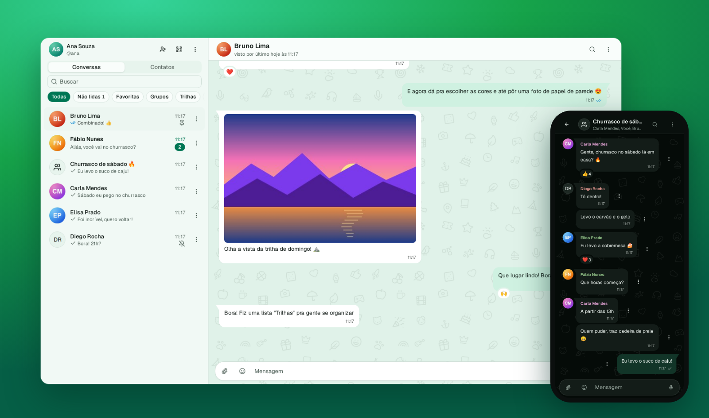
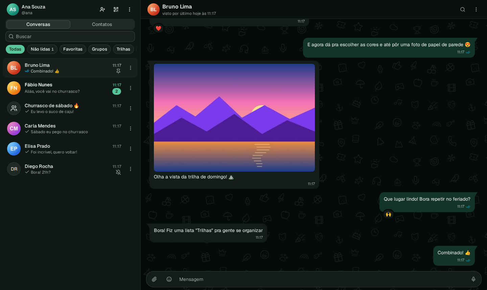
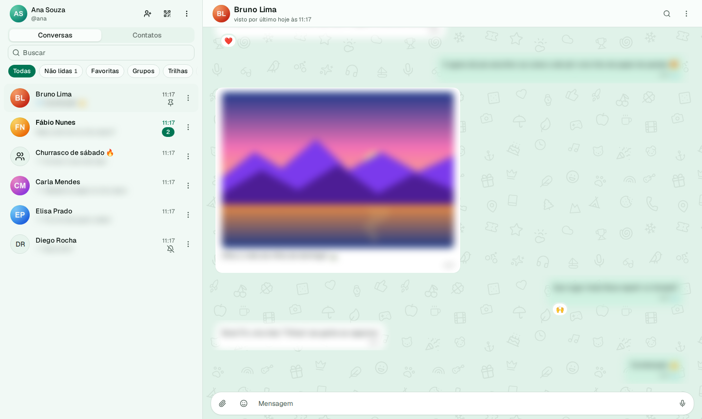
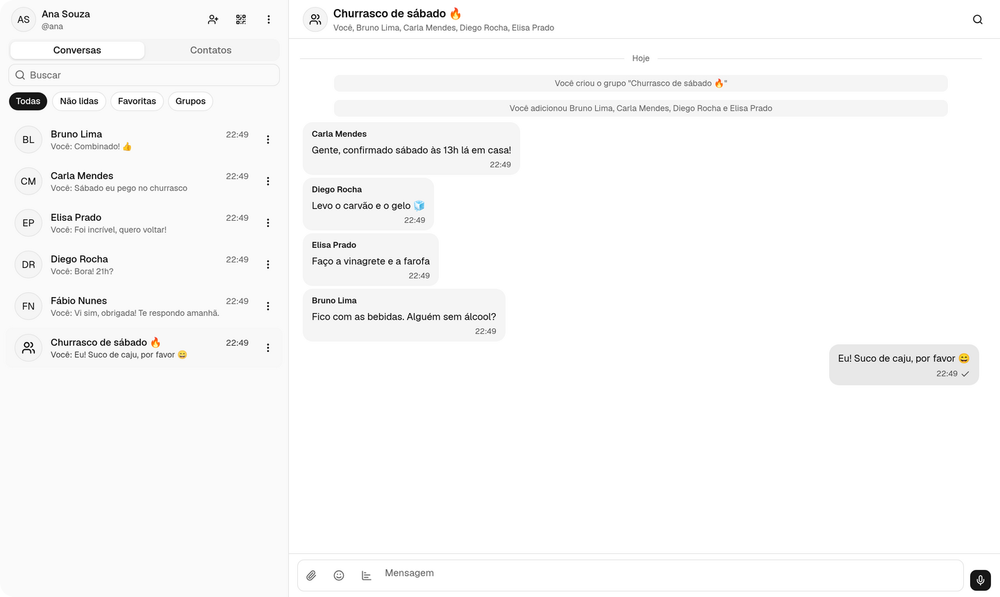
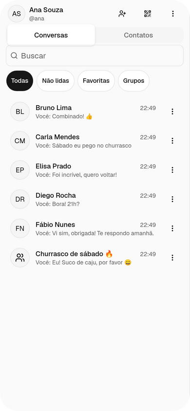

<p align="center">
  
</p>

<p align="center">
  <a href="https://github.com/DanielFreitasDev/papinho/actions/workflows/ci.yml"></a>
  <a href="https://github.com/DanielFreitasDev/papinho/releases"></a>
  <a href="LICENSE"></a>
  <a href="#rodar-com-docker"></a>
  
  
  
  
  
</p>

<p align="center">
  <b>Chat web auto-hospedado, inspirado no WhatsApp Web, com privacidade nativa.</b><br>
  Comece na sua máquina com os amigos da rede local e leve para uma VPS com domínio e HTTPS quando quiser.
</p>

<p align="center">
  <a href="https://papinho.cepify.com.br"><b>🌐 papinho.cepify.com.br</b></a> ·
  <a href="#-destaques">Destaques</a> ·
  <a href="#-capturas-de-tela">Capturas</a> ·
  <a href="#desenvolvimento">Desenvolvimento</a> ·
  <a href="#rodar-com-docker">Docker</a> ·
  <a href="deploy/PRODUCAO.md">Produção</a>
</p>

<p align="center">
  
</p>

## ✨ Destaques

| | |
|---|---|
| 🏠 **Seu servidor, suas regras** | Um único `papinho.jar` serve o app, a API e o WebSocket na mesma origem. Os dados ficam no seu PostgreSQL. |
| 🔒 **Privacidade aplicada no servidor** | Visto por último, online, foto, recado e confirmação de leitura com reciprocidade; ninguém burla pelo navegador. |
| 🙈 **Modo privado e conversas trancadas** | Desfoque de mensagens, nomes e mídia (Alt+Shift+P), bloqueio de tela por PIN e conversas que só abrem com código. |
| ⚡ **Tempo real e offline** | STOMP sobre WebSocket com sincronização por sequência; PWA instalável, conversas recentes offline e fila de envio. |
| 👥 **Tudo de um mensageiro moderno** | Grupos com admins e convite por QR Code, transmissões, enquetes, figurinhas, temporárias, agendadas e visualização única. |
| 🎙️ **Áudio com transcrição** | Whisper no próprio navegador (o áudio não sai do aparelho) ou um provedor compatível com a API da OpenAI. |
| 🔑 **Login sem senha** | Passkeys (WebAuthn), verificação em duas etapas (TOTP) com códigos de recuperação e sessão por cookie. |
| 🔔 **Notificações push** | Web Push cifrado até o navegador, com opção de mostrar só "Nova mensagem". |
| 🛡️ **HTTPS na rede local** | CA própria com Name Constraints e página `/setup` com QR Code para instalar o certificado nos aparelhos. |

## 📸 Capturas de tela

<table>
  <tr>
    <td width="50%"><p align="center"><sub>Tema claro</sub></p></td>
    <td width="50%"><p align="center"><sub>Tema escuro</sub></p></td>
  </tr>
  <tr>
    <td width="50%"><p align="center"><sub>Modo privado: desfoca mensagens e prévias</sub></p></td>
    <td width="50%"><p align="center"><sub>Grupos</sub></p></td>
  </tr>
</table>

<p align="center">
  
  
  
  
</p>

<p align="center"><sub>Pessoas e conversas fictícias, capturadas de uma instância local.</sub></p>

> O progresso, requisito por requisito e com evidência, está em [`STATUS.md`](STATUS.md). As decisões de
> arquitetura estão em [`docs/adr/`](docs/adr/).

## Stack

| Camada | Tecnologia |
|---|---|
| Backend | Java 25, Spring Boot 4.1.1, Spring Modulith 2.1.1, Spring Security 7 (sessão por cookie, passkeys), Spring Session JDBC, Flyway, BouncyCastle 1.86 |
| Banco | PostgreSQL 18 (`compose.yaml`), Testcontainers nos testes |
| Frontend | Vite 8, React 19, TypeScript 6, shadcn/ui sobre Base UI, Tailwind v4, TanStack Router e Query, react-hook-form + zod, i18next |
| Testes | JUnit 6, AssertJ, ArchUnit, Modulith; Vitest, Testing Library, msw; Playwright + axe |
| Build | Maven 3.9 (wrapper) multi-módulo; Node 24 LTS e pnpm 10 instalados pelo `frontend-maven-plugin` |

## Pré-requisitos

- JDK **25** (Temurin recomendado).
- Docker (PostgreSQL de desenvolvimento e Testcontainers).
- Para trabalhar no frontend fora do Maven: Node **24.22.0** (`frontend/.nvmrc`) e `corepack enable`.

## Desenvolvimento

```bash
# 0. Uma vez (e sempre que o frontend mudar de dependências): gera e instala o JAR do SPA
./mvnw -B install -DskipTests

# 1. Backend em http://localhost:8080 (sobe o PostgreSQL do compose.yaml sozinho)
./mvnw -pl backend -Dskip.installnodepnpm -Dskip.pnpm -Dspring-boot.run.profiles=local spring-boot:run

# 2. Frontend com recarga instantânea em http://localhost:5173 (proxy de /api, /ws e /setup para :8080)
cd frontend && corepack enable && pnpm install && pnpm dev
```

Sem Docker Compose, rode `TestPapinhoApplication` (em `backend/src/test`) pela IDE: ela sobe o PostgreSQL
com Testcontainers.

## Testes

```bash
./mvnw -B verify                    # backend: unitários, integração (Testcontainers), ArchUnit, Modulith
cd frontend && pnpm format:check && pnpm lint && pnpm typecheck && pnpm test && pnpm build

# e2e contra um papinho.jar em execução
./mvnw -B install -DskipTests
java -jar backend/target/papinho.jar &                      # precisa do PostgreSQL (variáveis abaixo)
cd frontend && pnpm exec playwright install chromium firefox webkit && PAPINHO_E2E_URL=http://localhost:8080 pnpm e2e
```

O e2e do e-mail de recuperação só roda com `PAPINHO_E2E_MAILPIT_URL` (por exemplo, um `axllent/mailpit` em
`localhost:1025`/`8025` e o jar iniciado com as variáveis de e-mail abaixo), como no CI.

O spec `native-controls.spec.ts` confere que nenhuma tela tem controles com a aparência do navegador (UI-05) e tira
capturas em Chromium, Firefox e WebKit, nos temas claro e escuro (ficam em `frontend/test-results` e no relatório
HTML do CI). O WebKit recusa cookies `Secure` em `http://localhost`, então roda contra uma instância HTTPS do perfil
`lan` (a mesma base de dados): `PAPINHO_E2E_HTTPS_URL=https://127.0.0.1:8443`. Sem essa variável, o WebKit é pulado.

O spec `whisper.spec.ts` transcreve um áudio de verdade com o Whisper no navegador: baixa ~80 MB do Hugging Face,
então só roda com `PAPINHO_E2E_WHISPER=1` (e `PAPINHO_E2E_PROXY=http://host:porta` se a internet passa por um
proxy). O projeto `desktop-chromium` cobre o WASM e o `whisper-webgpu` (que só existe com essa variável) cobre o
WebGPU com o adaptador por software do Chromium, bem mais lento:

```bash
PAPINHO_E2E_WHISPER=1 PAPINHO_E2E_URL=http://localhost:8080 pnpm e2e whisper.spec.ts --project=desktop-chromium --project=whisper-webgpu
```

## Configuração

| Variável | Padrão | Uso |
|---|---|---|
| `DATABASE_URL` | `jdbc:postgresql://localhost:5432/papinho` | JDBC do PostgreSQL |
| `DATABASE_USERNAME` / `DATABASE_PASSWORD` | `papinho` / vazio | credenciais do banco |
| `PAPINHO_PORT` | `8080` | porta HTTP (sem o perfil `lan`) |
| `PAPINHO_PKI_DIR` | `~/.papinho/pki` | diretório da PKI da LAN (fora do repositório) |
| `PAPINHO_HTTPS_PORT` / `PAPINHO_HTTP_PORT` | `8443` / `8080` | portas de escuta no perfil `lan` |
| `PAPINHO_PUBLIC_HTTPS_PORT` / `PAPINHO_PUBLIC_HTTP_PORT` | iguais às de escuta | portas que os amigos usam (80/443 com redirecionamento) |
| `PAPINHO_HSTS` | `false` | liga HSTS (produção) |
| `PAPINHO_FORWARD_HEADERS` | `none` | `native` atrás de proxy reverso (veja Produção) |
| `PAPINHO_DATA_DIR` | `~/.papinho` | base de `files/` (arquivos enviados), `uploads/` (uploads em andamento) e da chave de cifra |
| `PAPINHO_STORAGE_DIR` / `PAPINHO_UPLOAD_DIR` | dentro de `PAPINHO_DATA_DIR` | troca cada um desses diretórios |
| `PAPINHO_CLAMAV_ENABLED` | `false` | analisa cada arquivo com o ClamAV (`PAPINHO_CLAMAV_HOST`, `PAPINHO_CLAMAV_PORT`, padrão `localhost:3310`) |
| `PAPINHO_LINK_PREVIEW` | `true` | prévia de links buscada pelo servidor (desligue se a instância não deve acessar a internet) |
| `PAPINHO_GIFS_PROVIDER` / `PAPINHO_GIFS_API_KEY` | `none` / vazio | GIFs pelo Tenor (`tenor` com a chave da API); a busca e os GIFs passam pelo servidor (ADR 0011) |
| `PAPINHO_PUSH_ENABLED` | `true` | Web Push para os navegadores assinados (exige que o servidor acesse a internet) |
| `PAPINHO_PUSH_SUBJECT` | URL do projeto | contato da instância no VAPID (`mailto:` ou `https:`); use o seu |
| `PAPINHO_MAIL_ENABLED` | `false` | e-mail opcional de recuperação de senha; exige `PAPINHO_MAIL_FROM`, `PAPINHO_PUBLIC_URL` e o SMTP |
| `PAPINHO_MAIL_FROM` / `PAPINHO_PUBLIC_URL` | vazio | remetente e endereço público usado nos links (nunca o `Host` da requisição) |
| `SPRING_MAIL_HOST` / `SPRING_MAIL_PORT` / `SPRING_MAIL_USERNAME` / `SPRING_MAIL_PASSWORD` | vazio | servidor SMTP; STARTTLS com `SPRING_MAIL_PROPERTIES_MAIL_SMTP_STARTTLS_ENABLE=true` |

Com o e-mail ligado, cada pessoa pode cadastrar um e-mail de recuperação em Configurações > Segurança. Ele só
vale depois de confirmado pelo link enviado; "Esqueci minha senha" passa a oferecer um link de redefinição (uso
único, 1 hora), pedido pelo `@usuario` e sem revelar se a conta existe. Redefinir pelo e-mail encerra todas as
sessões, mas não desliga a verificação em duas etapas: quem perdeu o app autenticador usa um código de recuperação.

A cota por usuário (padrão 5 GB), as janelas de edição e exclusão e os provedores de transcrição ficam no
painel do admin. Arquivos têm limite de 1 GB e sobem por upload retomável (tus): atrás de um proxy, libere
`PATCH` em `/api/v1/uploads/**` com corpo de até 50 MB por requisição.

### Mensagens

Grupos (com admins, permissões e convite por link ou QR Code), listas de transmissão, mensagens salvas,
enquetes, figurinhas, mensagens temporárias, agendadas e de visualização única. Os jobs agendados (mensagens
temporárias, agendadas e limpeza da visualização única) usam o ShedLock: com mais de uma instância apontando para o
mesmo banco, só uma roda cada job. Figurinhas são WebP de até 1 MB enviados por qualquer pessoa da instância e
ficam disponíveis para todos.

### Privacidade

Tudo é aplicado no servidor: quem vê visto por último, online, foto e recado (com "meus contatos exceto…") e
quem pode adicionar você a grupos; quem não compartilha o visto por último ou o online não vê o dos outros, e
quem desliga a confirmação de leitura não vê a dos outros (no grupo ela vale por padrão e pode ser desligada em
cada um). Em Configurações > Privacidade também ficam:

- **Modo privado** (Alt+Shift+P): desfoca mensagens, prévias, nomes, fotos e mídia; revela com o mouse (na hora
  ou depois de alguns segundos), com o foco do teclado ou com um toque longo.
- **Bloqueio de tela**: PIN ou senha próprios, separados da senha da conta, com bloqueio por inatividade, ao
  trocar de aba ou janela e por atalho (tudo desligado por padrão). **É uma proteção visual**: a sessão continua
  ativa e quem tiver acesso às ferramentas do navegador ainda alcança os dados.
- **Conversas trancadas**: trancadas pelo painel da conversa com um código (o mesmo código em várias conversas
  abre todas juntas). Saem da lista e só abrem com o código; recarregar a página ou reiniciar o servidor tranca
  de novo. Um código esquecido não tem recuperação.

### Lista, busca e notificações

Cada pessoa organiza a própria lista: arquivar (com "manter arquivadas ao receber nova mensagem"), fixar até 3,
silenciar por 8 horas, 1 semana ou sempre (com a opção de ainda avisar menções), favoritar, listas personalizadas
(em Configurações > Conversas), limpar e apagar conversa. A busca usa o PostgreSQL com `unaccent`, `pg_trgm` e a
configuração `portuguese` (as extensões são criadas pela migração; o usuário do banco precisa poder criá-las ou
elas devem existir antes). Busca dentro da conversa por texto, remetente, dia e tipo.

Notificações: em Configurações > Notificações o botão pede a permissão do navegador. Com o app aberto o aviso vem
pelo WebSocket; com ele fechado, por **Web Push**, que passa pelo serviço de push do navegador (Google, Mozilla ou
Apple) e por isso **exige internet** no servidor e no aparelho. O conteúdo vai cifrado de ponta a ponta até o
navegador; "Ocultar conteúdo" (Privacidade) manda só "Nova mensagem". **No iPhone e no iPad** o push só funciona
com o Papinho instalado na tela de início (Safari > Compartilhar > Adicionar à Tela de Início). Cada navegador só
recebe push enquanto a sessão em que ele ligou as notificações existir: encerrar a sessão, trocar a senha ou o admin
desativar a conta cortam o push daquele aparelho.

Segurança da conta: adicionar uma passkey ou ativar a verificação em duas etapas pede a senha digitada nos últimos
5 minutos (o login por senha conta); assim, quem usar o aparelho destravado de alguém não deixa uma forma própria de
entrar. Cada código do app autenticador vale uma vez só no login.

### App instalável e offline

O Papinho é um PWA: o navegador oferece "Instalar" (ou "Adicionar à tela de início"). Quando sai uma versão nova, o
app avisa e só atualiza quando você toca em "Atualizar". Sem conexão, as conversas recentes continuam visíveis e
os textos escritos ficam numa fila que sai quando a conexão volta. Esses dados ficam no IndexedDB do navegador,
um banco por conta, apagado ao sair da conta ou quando outra conta entra no mesmo navegador; conversas trancadas
nunca são guardadas e nenhuma resposta da API vai para o cache do service worker.

### Transcrição de áudios

Por padrão os áudios são transcritos **no navegador** (Whisper com Transformers.js): o modelo (≈80 MB no
`base`, ≈250 MB no `small`) é baixado do Hugging Face na primeira vez em cada aparelho e o áudio não sai dele.
No painel do admin, aba Transcrição, dá para cadastrar provedores no servidor compatíveis com a API da OpenAI —
Groq (`https://api.groq.com/openai`, `whisper-large-v3-turbo`, até 25 MB), um Whisper próprio (com
`hotwords` e verificação em `GET {base}/health`), a OpenAI ou uma URL qualquer — e escolher o padrão. A chave
fica cifrada no banco e nunca volta para o navegador; cada pessoa escolhe o provedor em Configurações.

## Subir na rede local (HTTPS com CA própria)

Navegadores só liberam PWA, notificações, microfone e passkeys em HTTPS. Na LAN o Papinho usa uma CA
própria **restrita por Name Constraints** ao hostname e à faixa de IP da rede: instalada nos aparelhos dos
amigos, ela não consegue validar nenhum outro site (ADR 0007).

```bash
./mvnw -B install -DskipTests

# 1. Gera a CA e o certificado do servidor em ~/.papinho/pki (chaves 0600). Mostra a impressão digital.
java -jar backend/target/papinho.jar pki init                 # opções: --hostname --ip --network
#    rodar de novo reaproveita a CA; "pki renew" reemite só o certificado; "pki status" mostra a validade

# 2. Sobe com HTTPS (8443) e a porta HTTP de instalação (8080)
DATABASE_PASSWORD=... java -jar backend/target/papinho.jar --spring.profiles.active=lan
```

Na porta HTTP só existe `/setup/**`; o resto é redirecionado para HTTPS. A chave privada da CA **nunca**
deve sair da máquina nem entrar no repositório.

### Portas 80 e 443 (endereços sem porta)

Para que os amigos usem `http://papinho.lan/setup` e `https://papinho.lan/`, redirecione as portas no
host e informe as portas públicas:

```bash
sudo iptables -t nat -A PREROUTING -p tcp --dport 80  -j REDIRECT --to-ports 8080
sudo iptables -t nat -A PREROUTING -p tcp --dport 443 -j REDIRECT --to-ports 8443
PAPINHO_PUBLIC_HTTP_PORT=80 PAPINHO_PUBLIC_HTTPS_PORT=443 java -jar backend/target/papinho.jar --spring.profiles.active=lan
```

Alternativa: `sudo setcap 'cap_net_bind_service=+ep' "$(readlink -f "$(command -v java)")"` e
`PAPINHO_HTTP_PORT=80 PAPINHO_HTTPS_PORT=443`.

### Hostname na rede

O certificado vale para o hostname (padrão `papinho.lan`) e para o IP. Use o hostname: **passkeys exigem
um nome**, porque o WebAuthn não aceita IP como RP ID. Opções:

1. **DNS do roteador** (recomendado): reserve o IP do servidor no DHCP e crie a entrada `papinho.lan →
   IP`. Funciona em todos os aparelhos. Ressalvas: nem todo roteador permite entradas locais; se o IP
   mudar, rode `pki renew --ip <novo>` (o IP precisa continuar na faixa da CA).
2. **mDNS/Avahi**: gere a PKI com `pki init --hostname papinho.local` e anuncie o nome com o Avahi
   (`avahi-daemon`, hostname da máquina `papinho`). Ressalvas: mDNS só resolve nomes `.local`; Android e
   Windows antigos resolvem `.local` de forma irregular; redes de convidados costumam bloquear multicast.
3. **`/etc/hosts`** em cada computador: não funciona em celulares sem root.

### Instalar a CA nos aparelhos

Abra `http://papinho.lan:8080/setup` (ou o QR Code mostrado lá) em cada aparelho. A página detecta o
sistema e o navegador e mostra os passos para Ubuntu/Debian, Fedora, Arch, Windows, macOS, iOS/iPadOS,
Android e Firefox. **Confira a impressão digital SHA-256** com a que o `pki init` mostrou.

No Linux, um comando instala no sistema e nas bases NSS (Chrome e Firefox), conferindo a impressão digital
antes; é idempotente:

```bash
curl -fsSL http://papinho.lan:8080/setup/install-ca.sh | sh
curl -fsSL http://papinho.lan:8080/setup/install-ca.sh | sh -s -- --uninstall
```

`scripts/verify-install-ca.sh` testa esse script em contêineres Debian, Fedora e Arch.

## Rodar com Docker

A cada release, o CI publica a imagem no GitHub Container Registry, para `linux/amd64` e `linux/arm64` (roda
também num Raspberry Pi 4 ou 5 com sistema de 64 bits). As tags são a versão (`1.1.0`), `latest` e o commit
(`sha-xxxxxxx`); a mesma versão da release e do `papinho.jar` anexado a ela.

```bash
docker pull ghcr.io/danielfreitasdev/papinho:latest
```

Um `compose.yaml` com o Papinho e o PostgreSQL 18:

```yaml
# Papinho + PostgreSQL 18. Antes de subir: troque as duas senhas (iguais) e, fora do localhost, o endereço público.
services:
  papinho:
    image: ghcr.io/danielfreitasdev/papinho:latest
    restart: unless-stopped
    depends_on:
      postgres:
        condition: service_healthy
    ports:
      - "8080:8080"
    environment:
      DATABASE_URL: jdbc:postgresql://postgres:5432/papinho
      DATABASE_USERNAME: papinho
      DATABASE_PASSWORD: troque-esta-senha
      # Endereço que as pessoas usam: passkeys e links de e-mail dependem dele. Num domínio, com HTTPS no proxy:
      # https://chat.exemplo.com.br nas três variáveis (no RP_ID, só o domínio) e as duas linhas comentadas abaixo.
      PAPINHO_PUBLIC_URL: http://localhost:8080
      PAPINHO_ALLOWED_ORIGINS: http://localhost:8080
      PAPINHO_RP_ID: localhost
      # PAPINHO_FORWARD_HEADERS: native
      # PAPINHO_HSTS: "true"
    volumes:
      - papinho-data:/data

  postgres:
    image: postgres:18-alpine
    restart: unless-stopped
    environment:
      POSTGRES_DB: papinho
      POSTGRES_USER: papinho
      POSTGRES_PASSWORD: troque-esta-senha
    volumes:
      - postgres-data:/var/lib/postgresql
    healthcheck:
      test: ["CMD-SHELL", "pg_isready -U papinho -d papinho"]
      interval: 5s
      timeout: 3s
      retries: 10

volumes:
  papinho-data:
  postgres-data:
```

```bash
docker compose up -d   # depois, http://localhost:8080: a primeira conta criada vira admin
```

- A imagem roda como usuário sem privilégios (uid 10001) e guarda tudo em `/data` (`PAPINHO_DATA_DIR`): arquivos
  enviados, uploads em andamento e a chave de cifra `secret.key`. Faça backup dos dois volumes (veja
  [Backup](#backup)); num diretório do host no lugar do volume, dê a ele o dono certo:
  `sudo chown -R 10001:10001 ./dados`.
- `docker ps` mostra a saúde (`healthy`), conferida em `/actuator/health`. A JVM usa até 75% da memória do
  contêiner; para mudar, `JAVA_TOOL_OPTIONS`.
- Fora do `localhost`, sirva por HTTPS num proxy reverso (Caddy, nginx, Traefik): os cookies de sessão são
  `Secure` e as passkeys exigem um endereço seguro. As regras do proxy estão em [Produção](#produção-vps); as
  outras variáveis, em [Configuração](#configuração). O perfil `lan` (CA própria) é para rodar o JAR direto na
  máquina.
- Para construir a imagem a partir do código: `docker build -t papinho .`.

## Produção (VPS)

A instância oficial roda em **https://papinho.cepify.com.br** atrás de um Cloudflare Tunnel, com deploy automático
a cada push na `main` (CI → deploy na VPS com rollback → GitHub Release e imagem no GHCR). Detalhes em
[`deploy/PRODUCAO.md`](deploy/PRODUCAO.md).

- Rode **sem** o perfil `lan`: a PKI fica desligada e `/setup` não existe. O TLS vem do proxy reverso
  (Caddy, nginx, Traefik) ou de uma CA pública.
- Atrás do proxy: `PAPINHO_FORWARD_HEADERS=native`, `PAPINHO_HSTS=true`; o proxy precisa repassar
  WebSocket em `/ws`, o cabeçalho `Host` original e `X-Forwarded-For`/`X-Forwarded-Proto`.
  - Com `native`, o Tomcat lê o `X-Forwarded-For` de trás para a frente e só confia em proxies de endereço interno
    (loopback, 10/8, 172.16/12, 192.168/16…): o IP que um cliente inventa no começo do cabeçalho é ignorado e não
    burla os limites de tentativas. Se o proxy está em outra máquina com IP público, diga qual é em
    `SERVER_TOMCAT_REMOTEIP_INTERNAL_PROXIES` (expressão regular).
  - Não use `framework`: ele confia no primeiro valor do `X-Forwarded-For` ou do `Forwarded`, que o próprio cliente
    escolhe quando o proxy só acrescenta o dele (o padrão do nginx com `$proxy_add_x_forwarded_for`).
- PostgreSQL gerenciado ou em contêiner com volume e backup.
- O proxy precisa aceitar corpos de até 50 MB em `PATCH /api/v1/uploads/**` (pedaços do upload retomável).

## Backup

O backup da instância leva o banco (`pg_dump` em formato custom) e o diretório de dados (`PAPINHO_DATA_DIR`:
arquivos enviados, a chave de cifra `secret.key` e, no padrão, a PKI da LAN) num único `.tar` com SHA-256 de cada
parte. **Guarde-o como um segredo**: ele contém a chave de cifra e a chave privada da CA (o arquivo sai com
permissão 0600).

```bash
# Com o PostgreSQL do compose.yaml (o pg_dump precisa ser da versão 18; sem ele, use o do contêiner):
PGPASSWORD=papinho PAPINHO_PG_CONTAINER=papinho-postgres-1 scripts/backup.sh /caminho/dos/backups
```

Sem `PAPINHO_PG_CONTAINER`, o script usa o `pg_dump` local com as variáveis `PGHOST`, `PGPORT`, `PGUSER`,
`PGPASSWORD` e `PGDATABASE` (padrão `papinho`). Uploads em andamento ficam de fora. Para agendar, um cron
diário basta; guarde cópias fora da máquina.

Para restaurar, **pare o Papinho**, crie um banco vazio (ou um contêiner novo) e use um diretório de dados vazio:

```bash
PGPASSWORD=papinho PAPINHO_PG_CONTAINER=papinho-postgres-1 PAPINHO_DATA_DIR=~/.papinho \
  scripts/restore.sh /caminho/dos/backups/papinho-backup-AAAAMMDD-HHMMSS.tar
```

O `restore.sh` confere o SHA-256, recusa um banco que já tenha tabelas ou um `files/` com conteúdo (nunca mistura
duas instâncias) e restaura banco e arquivos. Suba o Papinho com o mesmo `PAPINHO_DATA_DIR` (ou a mesma
`PAPINHO_CRYPTO_KEY`): sem a chave de cifra, TOTP, chaves de provedores e a chave VAPID ficam ilegíveis.
`scripts/verify-backup.sh` testa o ciclo inteiro (Docker): instância com dados, backup, restauração num banco
novo e conferência de login, mensagem, foto e segredos cifrados.

Cada pessoa também pode exportar uma conversa (menu da conversa > Exportar, texto no formato do WhatsApp com
mídia opcional) e todos os seus dados (Configurações > Conta > Seus dados), e excluir a própria conta.

## Guias e decisões

- [`PROMPT.md`](PROMPT.md): especificação e contrato de trabalho; [`STATUS.md`](STATUS.md): progresso.
- [`docs/adr/`](docs/adr/): decisões de arquitetura.
- Guias na raiz: `STRUCTURE.md`, `JAVA.md`, `UI.md`, `RESPONSIVENESS.md`, `COMMITS.md`, `CONTEXT.md`.

## Licença

O Papinho é software livre, sob a [GNU Affero General Public License v3.0](LICENSE) ou (a seu critério) qualquer
versão posterior. Em resumo: pode usar, estudar, modificar e redistribuir; quem oferece uma versão modificada pela
rede precisa disponibilizar o código-fonte dela às pessoas que a usam. O aviso de copyright e a permissão adicional
(seção 7) para combinar o programa com o AspectJ, que vem com o Spring, estão em [`NOTICE`](NOTICE).
